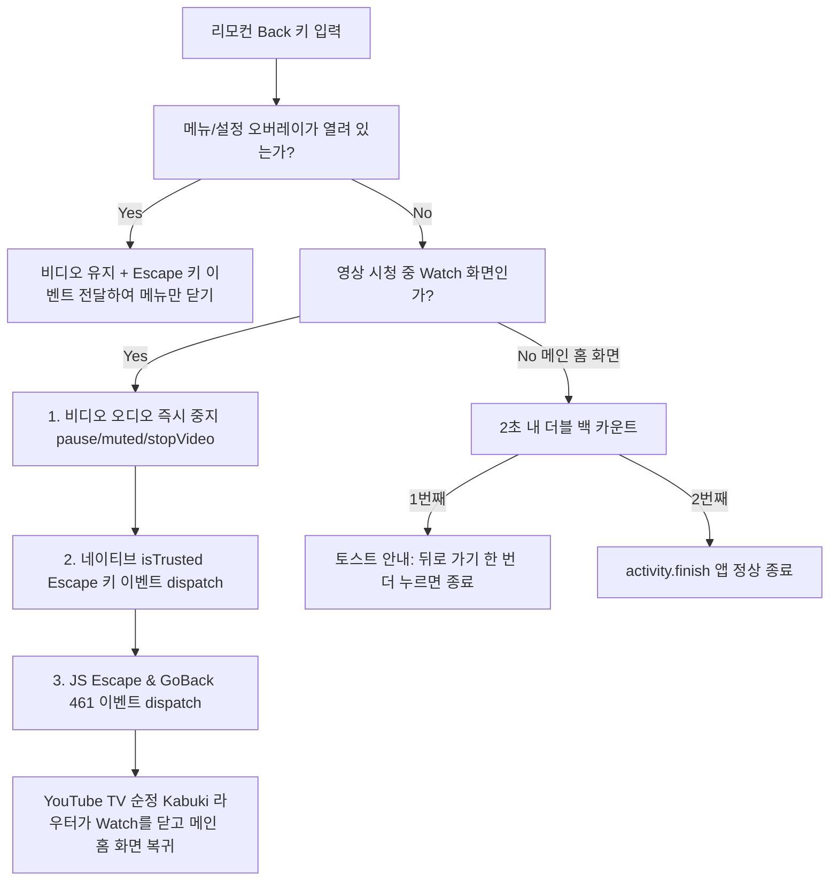

# 구현 계획서: 영상 시청 중 뒤로 가기 시 메인 홈 화면 복귀 정상화

- **기능 슬러그**: `back_key_navigation_fix`
- **작성일**: 2026-10-16
- **대상 파일**:
  - `app/src/main/assets/h5vcc_polyfill.js`
  - `app/src/main/java/com/k2/youtubetv/remote/TVRemoteKeyHandler.kt`

---

## 1. 개요 및 사용자 버그 리포트
- **증상**: 영상 재생 중 리모컨의 뒤로 가기(Back) 버튼을 누르면 직전 메인 홈 화면으로 돌아가지 않고 **"계정 선택(Who's watching? / Choose an account)"** 화면으로 튕기는 치명적인 문제 발생.
- **요구사항**: 영상 재생 중 뒤로 가기를 누르면 비디오가 안전하게 종료되고 **메인 홈 화면(Browse)**으로 즉시 복귀해야 함.

---

## 2. 심층 역공학 원인 분석 (Root Cause)

### 2.1 YouTube on TV 웹앱 (Kabuki Framework) 네비게이션 구조
- YouTube TV는 SPA(Single Page Application)로서 브라우저 `window.history`를 사용하지 않고 자체 내부 뷰 스택(`this.history`)으로 화면을 관리함.
- 앱 실행 흐름:
  1. `https://www.youtube.com/tv?launch=menu`로 최초 접속
  2. 사용자가 계정 선택(Who's watching) 화면에서 프로필을 선택하여 메인 화면(Home/Browse)으로 진입
  3. 영상을 선택하여 Watch Screen으로 진입 (브라우저 히스토리는 push되지 않고 화면 오버레이 컴포넌트만 변경)
- 이때 브라우저 레벨의 `window.history.back()` 또는 `webView.goBack()`을 실행하면, SPA 내부 상태와 무관하게 브라우저 히스토리 이전 엔트리인 **최초 부팅/계정 선택 화면(`launch=menu`)으로 통째로 롤백**됨.

### 2.2 기존 코드의 3중 트리거 버그
1. **`h5vcc_polyfill.js`의 `_k2LastBrowse` 오염**:
   - 부팅 시 `_k2PrevUrl`에 `https://www.youtube.com/tv?launch=menu`가 저장됨.
   - `TVRemoteKeyHandler.kt`에서 `window.location.replace(window._k2LastBrowse)`를 호출하여 `launch=menu`로 강제 새로고침 $\rightarrow$ 계정 선택 화면 뜸.
2. **`TVRemoteKeyHandler.kt`의 `window.history.back()` 강제 호출**:
   - Watch 화면에서 버튼을 못 찾으면 `window.history.back()`을 실행하여 계정 선택 화면으로 롤백.
3. **`TVRemoteKeyHandler.kt`의 `webView.goBack()` 실행**:
   - `webView.canGoBack()`이 true일 때 `webView.goBack()`을 호출하여 계정 선택 화면으로 롤백.

---

## 3. 수정 및 개선 방안 (Fix Architecture)

### 3.1 `h5vcc_polyfill.js` 수정
- 불필요하고 계정 화면으로 강제 리로드시키는 `_k2LastBrowse` 감시 루프 전면 제거.

### 3.2 `TVRemoteKeyHandler.kt` 수술적 수정
1. **오버레이 메뉴 감지 시**: 비디오를 멈추지 않고 메뉴만 닫기 (기존 유지).
2. **영상 시청 화면 감지 시**:
   - `video` 태그 즉각 음소거 및 정지 (`pause()`, `muted = true`, `player.stopVideo()`).
   - `location.replace`, `history.back()`, `webView.goBack()` 전면 제거.
   - 네이티브 WebView에 `KeyEvent.KEYCODE_ESCAPE` (DOWN & UP) 전달 (`NEEDS_ESCAPE`).
   - JS 이벤트로 `Escape` (27) 및 `GoBack` (461) 키 이벤트 전달.
3. **메인 홈 화면 감지 시**:
   - `history.back()`으로 계정 선택으로 빠지지 않도록 하고, 2초 내 더블 백 종료 시스템 유지.

---

## 4. 검증 계획 (Verification Plan)
1. 사전/사후 빌드 검증: `.\gradlew.bat assembleDebug` 성공 및 `YT_TV_AC.apk` 산출물 확인
2. 한글 리터럴 무결성 검증
3. Git diff 수술 부위 확인
