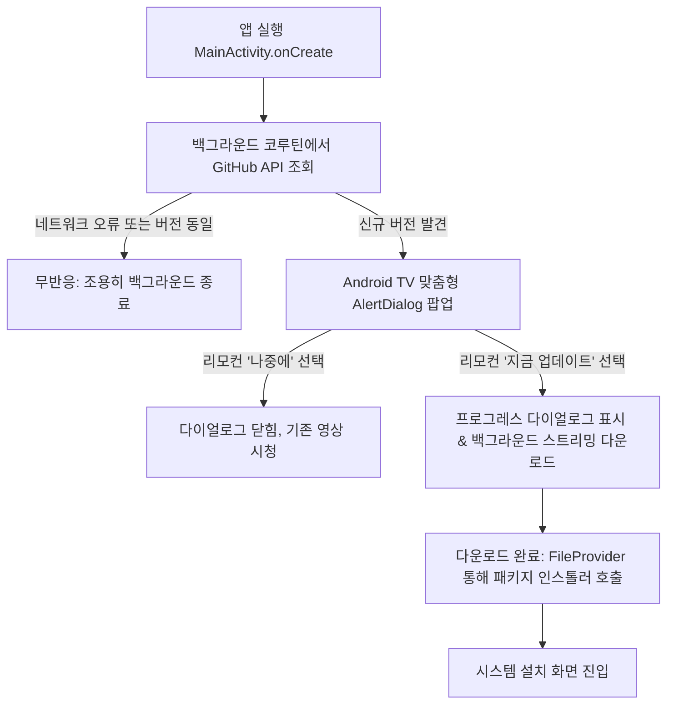

# 구현 계획서: GitHub 릴리즈 기반 인앱 자동 업데이트(OTA) 감지 및 설치

- **기능 슬러그**: `github_ota_update`
- **작성일**: 2026-10-16
- **대상 프로젝트**: `YT_TV_AC` (YouTube for Android TV Clone)

---

## 1. 개요 및 목적
사용자가 빌드된 APK를 GitHub 저장소([`k2love/YT_AC`](https://github.com/k2love/YT_AC))의 Release로 업로드할 때마다, Android TV 앱이 실행 시 최신 버전을 자동으로 감지하고 TV 리모컨 조작을 통해 원클릭으로 다운로드 및 업데이트 설치할 수 있는 인앱 OTA(Over-The-Air) 시스템을 구축합니다.

---

## 2. 세부 사양 및 아키텍처

### 2.1 GitHub Releases API 명세
- **엔드포인트**: `https://api.github.com/repos/k2love/YT_AC/releases/latest`
- **통신 방식**: OkHttp + Kotlin Coroutines (`Dispatchers.IO`)
- **응답 데이터 분석**:
  - `tag_name`: 최신 버전 태그 (예: `v1.0.1` 또는 `1.0.1`)
  - `name`: 릴리즈 제목
  - `body`: 변경 사항 (릴리즈 노트)
  - `assets`: 릴리즈에 첨부된 파일 목록 (`name.endsWith(".apk")` 필터링)
  - `browser_download_url`: APK 직접 다운로드 URL

### 2.2 버전 비교 알고리즘 (Semantic Versioning)
- 현재 앱 버전: `BuildConfig.VERSION_NAME` (예: `"1.0.0"`)
- 원격 태그 버전: `tag_name` 접두사(`v`, `V`) 제거 후 정수 배열 분리 (`split(".")`)
- 예: `1.0.1` vs `1.0.0` $\rightarrow$ $1==1$, $0==0$, $1 > 0$ $\rightarrow$ **업데이트 대상** 판정

### 2.3 Android TV 맞춤형 UI/UX 흐름

### 2.4 다운로드 및 안전 설치 파이프라인
1. 앱 전용 외부 저장소(`context.getExternalFilesDir(Environment.DIRECTORY_DOWNLOADS)`)에 `YT_TV_AC_latest.apk` 다운로드
2. 다운로드 스트림 바이트를 읽으며 프로그레스 다이얼로그 게이지 갱신
3. `androidx.core.content.FileProvider`를 통해 `content://` URI 생성
4. `Intent.ACTION_VIEW` (`application/vnd.android.package-archive`) 및 `FLAG_GRANT_READ_URI_PERMISSION` 플래그로 시스템 패키지 인스톨러 호출

---

## 3. 수정 및 생성 파일 계획

### 3.1 신규 파일
1. `app/src/main/res/xml/file_paths.xml`: FileProvider 경로 설정 파일
2. `app/src/main/java/com/k2/youtubetv/update/UpdateInfo.kt`: 릴리즈 정보 데이터 모델 및 버전 비교 유틸리티
3. `app/src/main/java/com/k2/youtubetv/update/AppUpdateManager.kt`: GitHub API 조회, UI 다이얼로그 표시, 다운로드 및 인스톨 트리거 총괄

### 3.2 수정 파일 (수술적 최소 수정)
1. `app/src/main/AndroidManifest.xml`:
   - `android.permission.REQUEST_INSTALL_PACKAGES` 권한 추가
   - `<provider>` 태그로 `androidx.core.content.FileProvider` 등록
2. `app/src/main/java/com/k2/youtubetv/MainActivity.kt`:
   - `onCreate()` 하단에 `AppUpdateManager(this).checkForUpdates()` 단 한 줄 연결

---

## 4. 검증 계획 (Verification Plan)
1. **사전 및 사후 빌드 검증**: `.\gradlew.bat assembleDebug` 빌드 성공 확인
2. **APK 산출물 확인**: `app/build/outputs/apk/debug/YT_TV_AC.apk` 정상 생성 여부
3. **한글 리터럴 및 인코딩 무결성 검증**: 다이얼로그 및 문자열 깨짐 전수 점검
4. **테스트 시나리오**:
   - 최신 버전과 현재 버전이 같을 때 (무반응 유지)
   - 최신 버전이 더 높을 때 (TV 다이얼로그 표시 및 다운로드 트리거)
