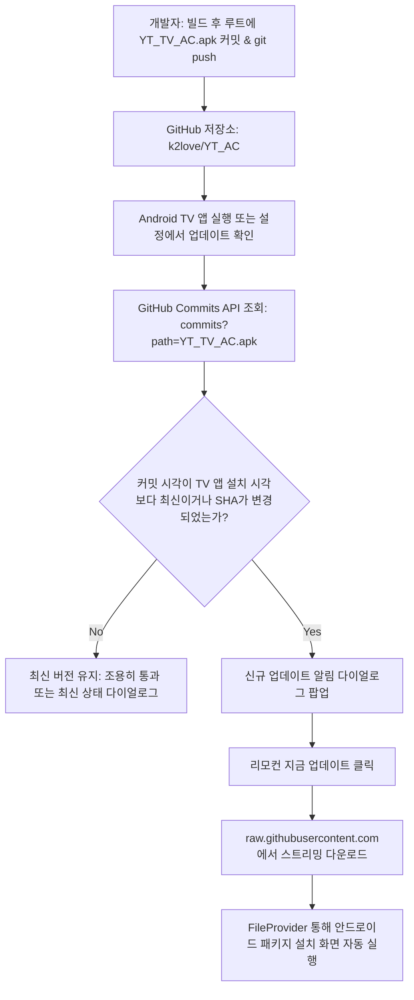

# 구현 계획서: 루트 APK 커밋 감지 기반 자동 업데이트(OTA) 구축

- **기능 슬러그**: `root_apk_commit_updater`
- **작성일**: 2026-10-16
- **대상 파일**:
  - `.gitignore`
  - `app/src/main/java/com/k2/youtubetv/update/AppUpdateManager.kt`
  - 루트 디렉토리: `YT_TV_AC.apk`

---

## 1. 개요 및 목적
`TV_YouTube_Ad_Skipper` 프로젝트에서 검증된 고효율 업데이트 방식을 도입합니다.
사용자가 번거롭게 GitHub 웹의 Releases 페이지에 들어갈 필요 없이, 로컬에서 빌드된 `YT_TV_AC.apk`를 프로젝트 루트에 넣고 `git push`만 하면 TV 앱이 GitHub Commits API를 통해 파일의 커밋 시각 및 SHA 변경을 즉시 감지하여 자동 업데이트 팝업을 띄우고 설치까지 원클릭으로 진행할 수 있도록 구현합니다.

---

## 2. 세부 사양 및 아키텍처

### 2.1 API 및 다운로드 명세
- **커밋 감지 엔드포인트**:
  `https://api.github.com/repos/k2love/YT_AC/commits?path=YT_TV_AC.apk&sha=main&page=1&per_page=1`
- **직다운로드 URL**:
  `https://raw.githubusercontent.com/k2love/YT_AC/main/YT_TV_AC.apk`
- **감지 알고리즘**:
  1. 기기에 설치된 앱의 `packageInfo.lastUpdateTime` 획득
  2. GitHub 커밋의 `commit.committer.date` (ISO-8601 UTC)를 밀리초로 변환
  3. `(remoteCommitTime > localInstalledTime + 60_000L)` 또는 `(savedSha != currentSha)` 시 업데이트 판정!
  4. SharedPreferences(`update_prefs`)에 최신 SHA 보존

### 2.2 하이브리드 지원
- 루트 커밋 감지(메인)와 GitHub Releases 감지(보조)를 둘 다 지원하여, 어떤 방식으로 업로드하든 TV가 100% 감지하도록 설계.

---

## 3. 수정 계획
1. `.gitignore`: `*.apk` 예외로 `!/YT_TV_AC.apk` 등록하여 루트 APK만 추적 허용
2. `app/build/outputs/apk/debug/YT_TV_AC.apk`를 프로젝트 루트 `YT_TV_AC.apk`로 복사
3. `AppUpdateManager.kt`에 `checkRemoteApkCommitUpdated()` 메서드 및 SharedPreferences 기반 SHA 감지 로직 이식
4. 빌드 검증 및 깃허브 푸시
