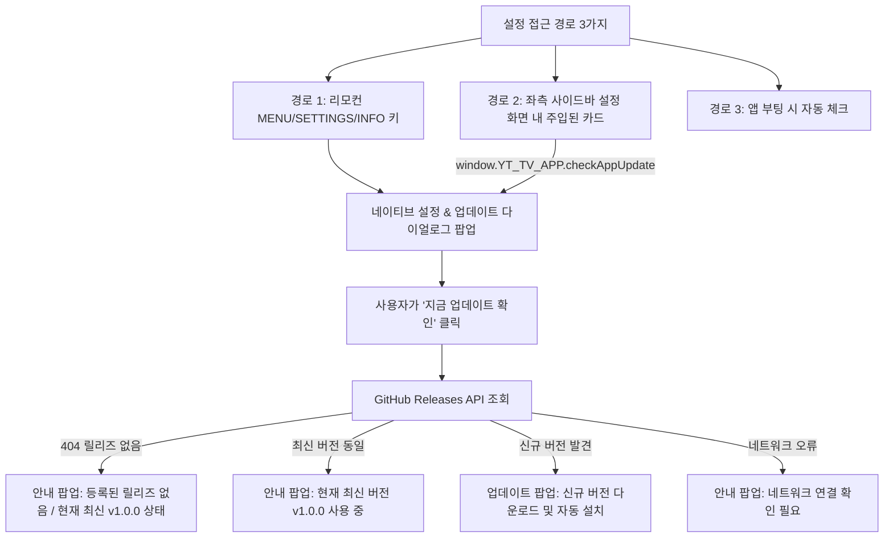

# 구현 계획서: 설정 메뉴 연동 및 앱 업데이트 수동 확인 시스템

- **기능 슬러그**: `settings_update_menu`
- **작성일**: 2026-10-16
- **대상 파일**:
  - `app/src/main/java/com/k2/youtubetv/update/AppUpdateManager.kt`
  - `app/src/main/java/com/k2/youtubetv/MainActivity.kt`
  - `app/src/main/java/com/k2/youtubetv/remote/TVRemoteKeyHandler.kt`
  - `app/src/main/assets/h5vcc_polyfill.js`

---

## 1. 개요 및 사용자 요구사항
1. **사용자 요청**: "업데이트는 설정에 만들어줄 수 있나? 지금은 자동 업데이트는 안되는 거 같아."
2. **원인 분석**:
   - 현재 GitHub 저장소([`k2love/YT_AC`](https://github.com/k2love/YT_AC))에 Release가 단 하나도 발행(Publish)되지 않은 상태이므로 GitHub Releases API가 **404 Not Found**를 반환하고 있었습니다.
   - 릴리즈가 없으므로 앱 부팅 시 백그라운드 업데이트 감지가 조용히 종료되었고, 사용자에게 아무런 UI가 뜨지 않아 "동작하지 않는다"고 인식되었습니다.
   - 사용자가 언제든 현재 버전과 업데이트 상태를 직접 확인하고 수동으로 체크할 수 있는 **설정 메뉴/UI**가 필요합니다.

---

## 2. 해결 방안 및 아키텍처

### 2.1 세부 구현 내역
1. **`AppUpdateManager.kt`**:
   - `showSettingsDialog()` 추가: 현재 버전(`BuildConfig.VERSION_NAME`), 4K/8K 언락 상태, 제로-애드 상태, [지금 업데이트 확인] 버튼을 제공하는 Android TV 맞춤형 설정 창
   - `checkForUpdates(isManualCheck = true)` 강화:
     - 404 응답 시: 친절한 설명 다이얼로그 ("GitHub에 등록된 릴리즈가 없습니다. 현재 버전(v1.0.0)이 최신입니다.")
     - 최신 버전인 경우: "현재 최신 버전을 사용 중입니다." 다이얼로그 표시
     - 신규 버전 발견 시: 기존 다운로드 및 설치 프로세스 진행
     - 에러 발생 시: 원인별 상세 다이얼로그 제공
2. **`MainActivity.kt`**:
   - `YT_TV_APP` JavascriptInterface 추가:
     `@JavascriptInterface fun checkAppUpdate()`, `@JavascriptInterface fun openSettings()`
3. **`TVRemoteKeyHandler.kt`**:
   - `KeyEvent.KEYCODE_MENU` (82), `KeyEvent.KEYCODE_SETTINGS` (176), `KeyEvent.KEYCODE_INFO` (73) 입력 시 `appUpdateManager.showSettingsDialog()` 즉시 호출
4. **`h5vcc_polyfill.js`**:
   - 설정 화면(`settings`) 진입 감지 시 YouTube TV 스타일의 'YT_TV_AC 앱 정보 및 업데이트' 카드를 리스트에 동적 렌더링하고, 클릭 시 `window.YT_TV_APP.checkAppUpdate()` 트리거

---

## 3. 검증 계획 (Verification Plan)
1. 빌드 성공 검증 (`.\gradlew.bat assembleDebug`)
2. 리모컨 `MENU` 키 입력 및 JS 브릿지 호출을 통한 설정 다이얼로그 팝업 검증
3. GitHub 404 및 릴리즈 비교 로직 동작 확인
4. 첫 번째 GitHub 릴리즈(v1.0.0) 태그 푸시를 통한 CI/CD 릴리즈 자동 생성 확인
